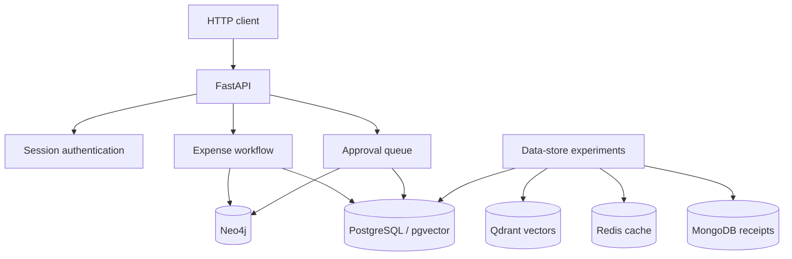

# Architecture and workflow notes

## Design goal

Explore how a backend can coordinate transactional expense decisions with document, cache, graph and vector stores. This is a prototype, not a fully deployed enterprise expense platform.

The database connections shown are logical responsibilities; **not every store is called during every API request**.

## Relational workflow

PostgreSQL is the source of truth for expenses, budgets and decisions. An approval:

1. Locks the expense row and checks its current status.
2. Refuses a decision by the submitter.
3. Locks its budget and checks that the supplied expected version is current.
4. Verifies authorization against Neo4j.
5. Checks remaining funds, deducts the approved amount and increments the budget version.
6. Changes the expense status and inserts the decision within the relational transaction.

Rejections create a decision without deducting budget. Escalations record an explicit target. A failed transaction rolls back changes. Tests cover duplicate decisions, concurrent approvals, stale versions and insertion failures.

## Neo4j authority

- `RESPONSIBLE_FOR`: direct cost-centre owner.
- `DELEGATED_TO`: multi-hop scoped authority, bounded by integer-cent amount limits and validity dates.
- `REVIEWER_FOR`: explicit independent reviewer for expenses **submitted by** the responsible owner.

Self-decisions are forbidden across authorization paths. For an ordinary employee's escalation, the responsible owner is the target. If the responsible owner is the submitter, the target is the independently assigned reviewer. A reviewer cannot use `REVIEWER_FOR` to approve arbitrary employees' expenses.

The approval queue computes authorization before pagination; its batched Neo4j checks cover both ordinary and independent-review paths. Assigned escalations remain target-specific and require *current* authority at decision time.

## Other stores

- **MongoDB** stores receipt-shaped documents and enforces a JSON Schema.
- **Redis** caches approver chains, with expiry and invalidation tests.
- **pgvector / Qdrant** store/search embeddings of example receipt and policy documents; the comparison exercises similarity search and metadata filtering.

The database experiments are useful demonstrations, but are not all exposed as endpoints in the current FastAPI surface.

## Important operational boundaries

- `GET /api/v1/health` is a liveness response, not a cross-database readiness probe.
- Sessions are hashed bearer tokens with expiration/revocation; there is currently no login route.
- The Neo4j reviewer model has no administrative assignment API and no PostgreSQL employment-status synchronization yet.
- Integration tests must be executed through `scripts/run_integration_tests.py` against isolated test services.
- The schema's PostgreSQL `api_sessions` migration is separate from the base `schema.sql`.

See the [current data-model reference](SCHEMA.md). Earlier materials are in the [coursework archive](coursework/README.md).

## Presentation walkthrough

A concise, accurate demonstration can show:

1. The five database responsibilities and where FastAPI uses them.
2. The request/response schema in `/docs` and the liveness endpoint.
3. A pending expense, approval queue and authorized decision using a pre-created internal session.
4. A rejected self-approval and an independently reviewed owner expense.
5. The integration test runner's preflight, test results and cleanup verification.

Avoid describing the prototype as production-ready or claiming that receipt OCR, public login, admin reviewer management or a Vue frontend is already implemented.
