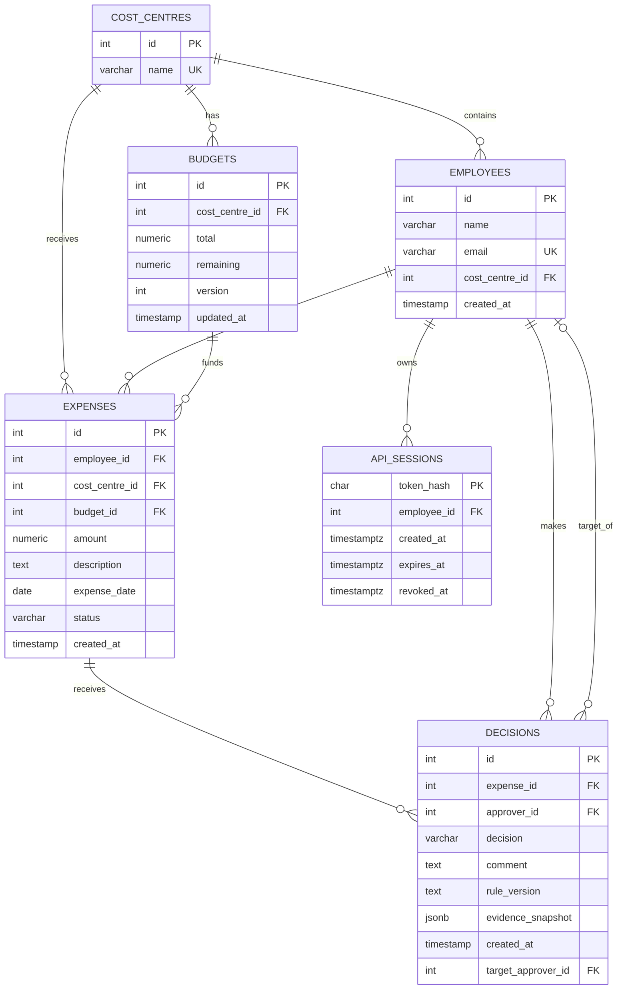
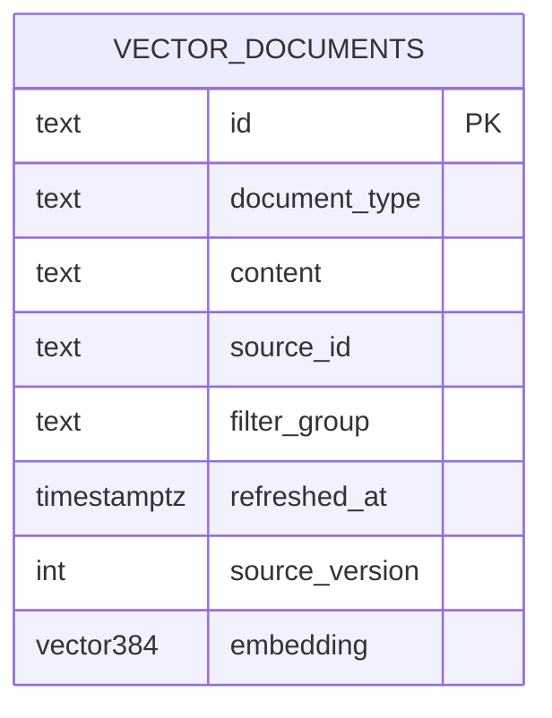

# Data model

This page describes the PostgreSQL schema in [`app/database/schema.sql`](../app/database/schema.sql) and the [API sessions migration](../app/database/migrations/001_api_sessions.sql). It replaces the original simplified coursework diagram.

## Relational model

`decisions.target_approver_id` is nullable and references an employee; an escalation records the employee to whom it is assigned. The base schema defines the other tables, while `api_sessions` is introduced separately by a migration. The additive `002_decision_evidence.sql` migration adds nullable evidence fields to existing decisions; new decisions record a rule version and JSONB snapshot. See [decision evidence](DECISION_EVIDENCE.md).

**Important constraints:** `budgets.remaining` must be between zero and `total`, and `budgets.version` supports concurrency checks; expense amounts are positive and statuses are `pending`, `approved`, `rejected`, or `escalated`. Decisions are `approved`, `rejected`, or `escalated`.

## Vector storage (PostgreSQL / pgvector)

`vector_documents` is independent of the transactional foreign-key graph; the vector is stored as `VECTOR(384)`. The corresponding Qdrant store is maintained separately rather than through a cross-database foreign key. `source_version` is optional and is NULL for legacy or unversioned documents. When the source supplies a version it is copied to PostgreSQL and Qdrant; `refreshed_at` records when each derived copy was written, not the timestamp of the source change.

## Other stores

- **Neo4j:** `Employee` and `CostCentre` nodes; `RESPONSIBLE_FOR`, `DELEGATED_TO` and `REVIEWER_FOR` authorization edges. IDs correspond to PostgreSQL employees and cost centres, but there are no cross-database foreign keys.
- **MongoDB:** receipt-shaped documents validated using a JSON Schema, including expense ID, vendor, country, VAT number, total, currency and receipt date.
- **Redis:** cached approver chains with expiration and invalidation.
- **Qdrant:** embeddings and metadata for receipt and policy similarity-search experiments.

See [architecture and workflow notes](ARCHITECTURE.md). Earlier materials are preserved in the [coursework archive](coursework/README.md).

This page documents schema structure, not a claim that operations across the five databases share an atomic transaction.
